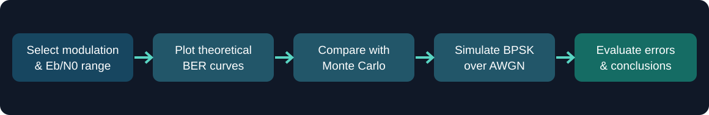
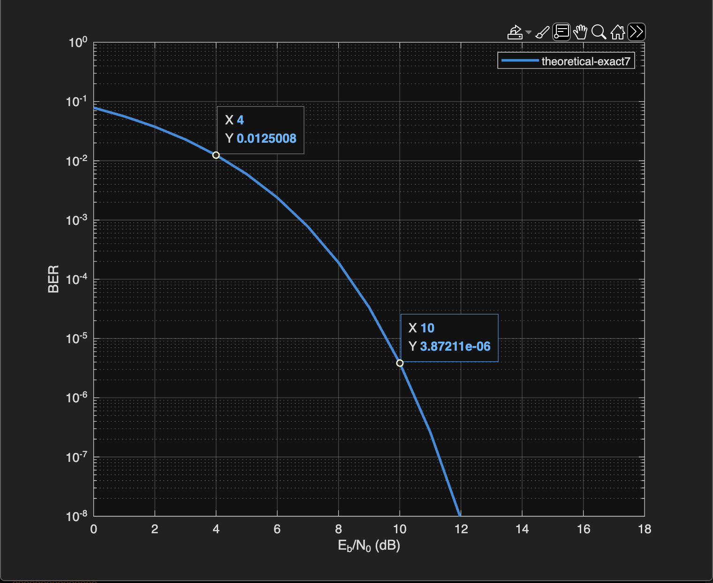
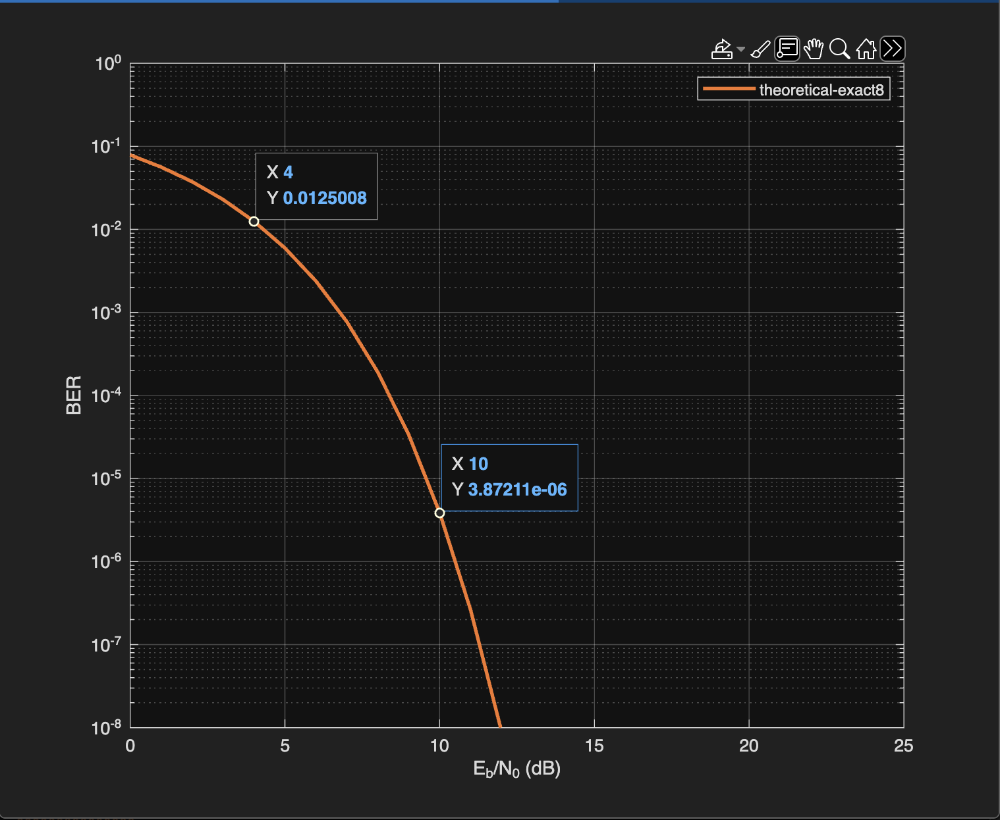
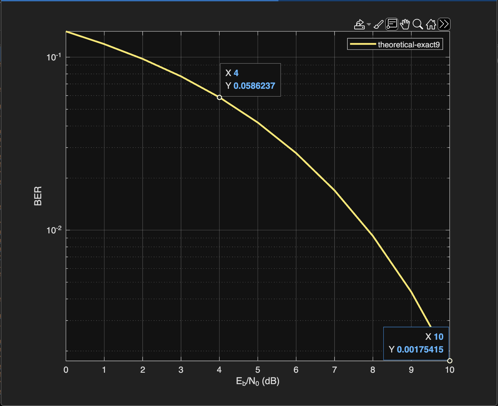
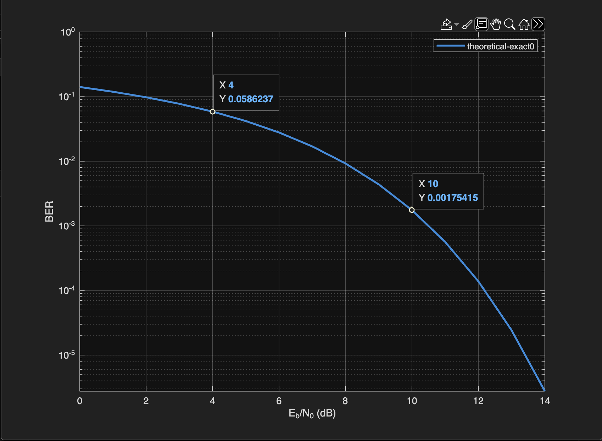
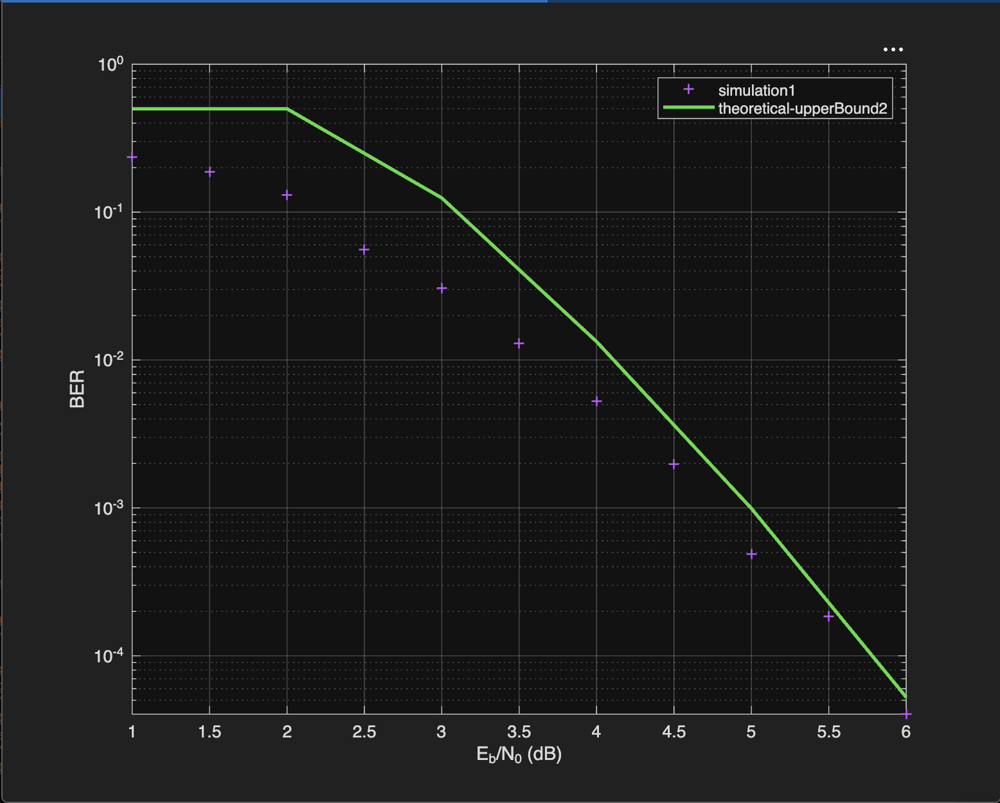
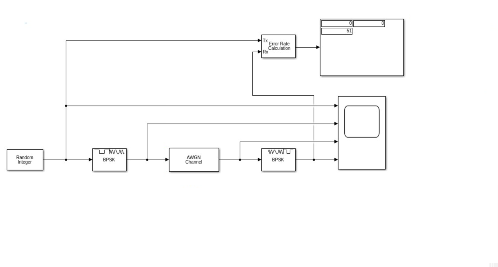
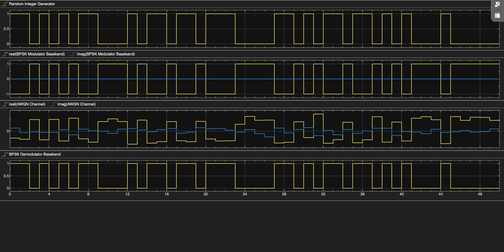
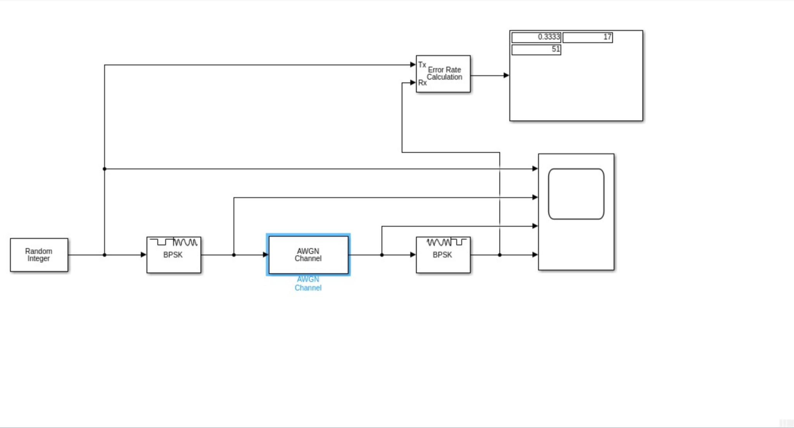
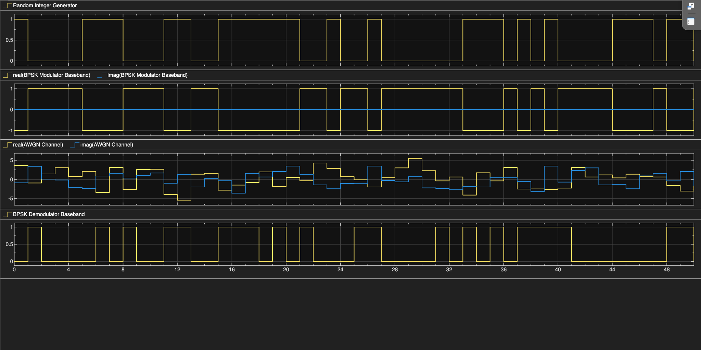

# CYSE 425 — Lab 2: BER and Digital Modulation Simulation

 

Analyzed **bit error rate (BER)** as a function of **energy-per-bit to noise-density ratio (Eb/N0)** using theoretical modulation curves and Monte Carlo results. Built a **BPSK modulation and demodulation model over an AWGN channel** and observed how increasing noise changes the received signal and error rate.

**Lab report:** [View the original 8-page PDF](docs/CYSE425_Lab2_Report.pdf)

## At a glance

| Item | Details |
|---|---|
| Focus | BER performance, modulation, noise, and signal recovery |
| Environment | MATLAB / Simulink (as shown in the lab screenshots) |
| Techniques | BER plotting, BPSK, 16-QAM, Monte Carlo comparison, AWGN simulation |
| Key outcome | Higher Eb/N0 reduced BER; the BPSK model showed 0 errors at 10 dB and 17 errors at -10 dB in 51-bit runs |

## Assessment Workflow

## Evidence Screenshots

All **9 screenshots** from the submitted Lab 2 report are shown below, in the order documented.

### Theoretical BER analysis

**01. BER curve for Eb/N0 = 0–18 dB**

*At 4 dB, BER = 0.0125008; at 10 dB, BER = 3.87211 × 10⁻⁶.*

**02. BER curve for Eb/N0 = 0–25 dB**

*Extending the x-axis range does not change the BER at the same Eb/N0 values.*

**03. 16-QAM BER curve for Eb/N0 = 0–10 dB**

*At 4 dB, BER = 0.0586237; at 10 dB, BER = 0.00175415.*

**04. 16-QAM BER curve for Eb/N0 = 0–14 dB**

*The extended curve shows BER continuing to decrease as Eb/N0 increases.*

### Monte Carlo comparison

**05. Simulation versus theoretical upper bound (modulation order 4)**

*The plot compares simulated BER samples over 1:0.5:6 dB with a theoretical upper-bound curve over 1:6 dB.*

### BPSK modulation and demodulation through AWGN

**06. Simulink block model at SNR = 10 dB**

*Random Integer Generator → BPSK Modulator → AWGN Channel → BPSK Demodulator → Error Rate Calculation.*

**07. Signal waveforms at SNR = 10 dB**

*The report shows no bit errors in this 51-bit comparison.*

**08. Simulink block model at SNR = -10 dB**

*The Error Rate Calculation display reports BER ≈ 0.3333 (17 errors in 51 compared bits).*

**09. Signal waveforms at SNR = -10 dB**

*Greater noise visibly distorts the signal, and the demodulated bit sequence differs from the transmitted sequence.*

## Findings and evidence

| Test | Results from the report | Observation |
|---|---|---|
| Initial BER curve (0–18 dB) | 4 dB: **0.0125008**; 10 dB: **3.87211 × 10⁻⁶** | BER decreases with Eb/N0 |
| Extended BER curve (0–25 dB) | Same BER values at 4 and 10 dB | Changing plot range does not change the underlying relationship |
| 16-QAM (0–10 dB and 0–14 dB) | 4 dB: **0.0586237**; 10 dB: **0.00175415** | BER decreases with Eb/N0 for 16-QAM |
| Monte Carlo / order 4 | Simulated samples compared with theoretical upper bound | The plotted simulation points are below the upper-bound curve over the shown range |
| BPSK, SNR = 10 dB | **0 errors / 51 bits**, BER = 0 | No errors were observed in the shown short run |
| BPSK, SNR = -10 dB | **17 errors / 51 bits**, BER ≈ 0.3333 | More noise produced more bit errors in the shown run |

## What this project demonstrates

- Interpretation of BER-versus-Eb/N0 plots for digital modulation.
- Comparison of theoretical and simulated modulation performance.
- Understanding of how AWGN affects BPSK transmission and detection.
- Construction and inspection of a Simulink BPSK transmit–channel–receive model.
- Evidence-based comparison of bit errors at high and low SNR.
